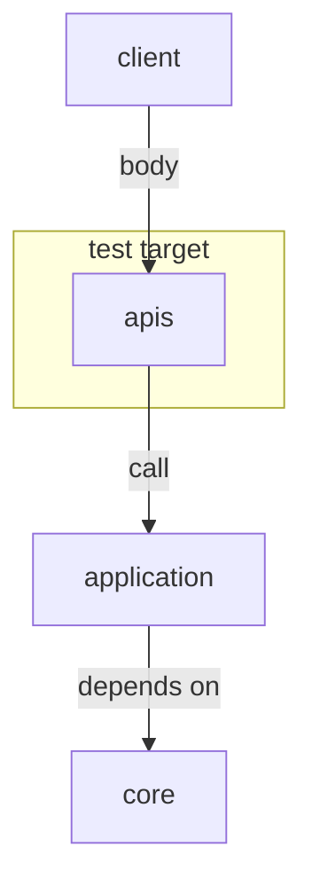

# API unit tests

## Test target
The targets are
- parse requests body to RequestSchema correctly
- call application(use case) function call correctly.
- parse useCase function response to ResponseSchema correctly



## How implement APIs unit tests
```python
def test_load_history(client, auth_headers):
    application_mock = Mock()
    with patch("recnavi.application.<target_function>"):  # patch application function
        response = client.post(
            "/<target endpoint>",
            headers=auth_headers,  # if needed
            json=<request body>,
        )

        assert response.status_code == 200  # check status code equal to expected code.
        res = response.json()
        assert res == expected_value

        application_mock.assert_called_once_with(  # check the application function called with expected args.
            key1=val1,
            key2=val2,
            ...
        )

```
